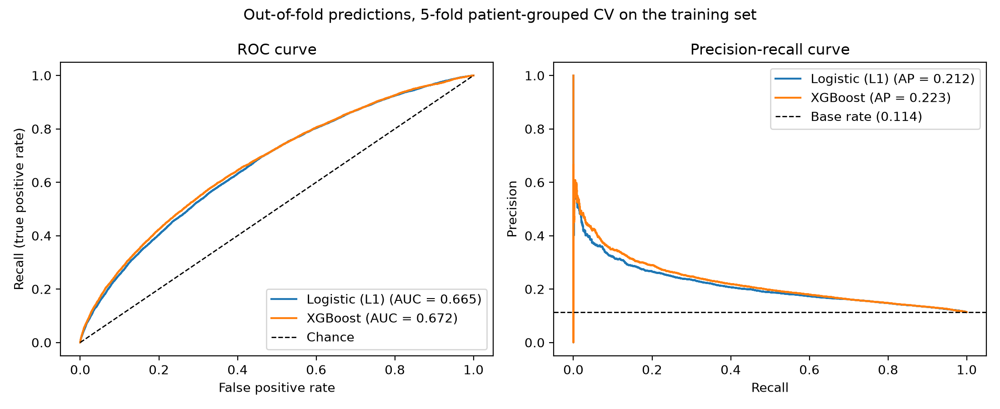
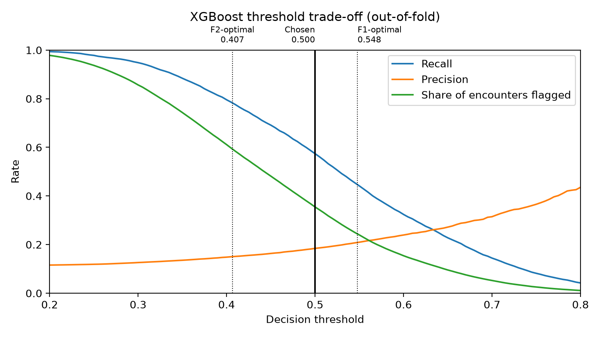
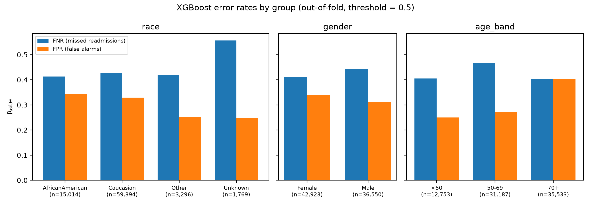

# Predicting 30-Day Hospital Readmission for Patients with Diabetes

This project builds a binary classifier that uses information available at discharge to predict whether a patient with diabetes will be readmitted within 30 days. A hospital could use the risk score to decide which patients get a follow-up call or a medication review after they go home.

It is the final project for DADS 7275 (Machine Learning and Data Analytics) at Northeastern University. The work is in progress: the data pipeline, two models, threshold selection and a first fairness audit are done. Tuning, interpretation, confidence intervals and the test-set evaluation come next (see [Status](#status)).

## Results so far

All numbers come from 5-fold cross-validation on the training set, with folds grouped by patient. The test set has not been used yet.

| Metric | Logistic regression (L1) | XGBoost |
|---|---|---|
| ROC-AUC (mean ± SD over folds) | 0.665 ± 0.007 | 0.672 ± 0.008 |
| PR-AUC / average precision | 0.213 | 0.224 |
| Recall at threshold 0.5 | 0.539 | 0.574 |
| Precision at threshold 0.5 | 0.182 | 0.184 |
| Share of stays flagged at 0.5 | 33.7% | 35.5% |
| Top-decile lift | 2.26 | 2.35 |

The base rate is 11.4%, so a random guess has a PR-AUC of about 0.11. XGBoost is ahead of the baseline in every fold, but only by 0.002 to 0.009 in ROC-AUC. A paired patient-level bootstrap will test whether that gap is real.



The decision threshold is fixed at 0.5 on the out-of-fold predictions. Because XGBoost is trained with `scale_pos_weight = 7.78` (the negative-to-positive ratio), a 0.5 cut-off assumes that missing a readmission costs about 7.8 times as much as a false alarm. The F1-optimal (0.548) and F2-optimal (0.407) thresholds are kept for comparison.



The fairness audit compares the false-negative rate (missed readmissions) and the false-positive rate (false alarms) across race, gender and age at that single threshold. Race is not a model input; it is used only for this audit. Two gaps are above the 0.10 flag: the false-negative rate of the small Unknown-race group (151 readmissions), and the false-positive rate for patients aged 70 and older. These are point estimates. Bootstrap confidence intervals are planned.



## Data

The project uses the **Diabetes 130-US Hospitals for Years 1999-2008** dataset from the UCI Machine Learning Repository (Clore et al., 2014; Strack et al., 2014). It has 101,766 hospital stays from 71,518 patients and 50 columns. The data is not stored in this repository, so you need to download it once:

1. Go to the dataset page: <https://archive.ics.uci.edu/dataset/296/diabetes+130-us+hospitals+for+years+1999-2008>
2. Click **Download** and unzip the file.
3. Create the folder `data/raw/` in the project root and copy these two files into it:
   - `diabetic_data.csv`
   - `IDS_mapping.csv` (code descriptions, used only for reference)

The folder should then look like this:

```
data/
└── raw/
    ├── diabetic_data.csv
    └── IDS_mapping.csv
```

## Setup

The code was written with Python 3.12.

```bash
git clone https://github.com/sara-ha-hub/hospital-readmission-prediction.git
cd hospital-readmission-prediction
python -m venv .venv
```

Activate the environment. On Windows (PowerShell):

```bash
.venv\Scripts\Activate.ps1
```

On macOS or Linux:

```bash
source .venv/bin/activate
```

Then install the packages:

```bash
pip install -r requirements.txt
```

## How to run

Run the three scripts in order from the project root:

```bash
python scripts/data_prep.py
python scripts/pipeline.py
python scripts/figures.py
```

| Script | What it does | Output |
|---|---|---|
| `data_prep.py` | Applies fixed row-level cleaning rules and creates the 30-day target | `data/processed/readmission_clean.csv` |
| `pipeline.py` | Splits by patient, runs grouped cross-validation for both models, compares thresholds, runs the fairness audit | Printed metrics, `reports/fairness_oof.csv`, `data/processed/oof_predictions.csv` |
| `figures.py` | Draws the figures from the saved out-of-fold predictions (no retraining) | `reports/figures/oof_*.png`, `reports/figures/fairness_fnr_fpr.png` |

`pipeline.py` trains each model several times, so it takes a few minutes. `figures.py` takes a few seconds.

## Method

**Cleaning (`data_prep.py`).** Only fixed rules that do not learn from the data run here, so they can safely run before the split:

- `?` is read as missing. `None` in the lab columns means "test not done" and is kept as its own value.
- Stays that ended in death or hospice (2,423) are removed, since those patients cannot be readmitted. Three rows with an invalid gender are also removed.
- The target `readmit_30d` is 1 for readmission within 30 days and 0 otherwise.
- `encounter_id`, `weight` (97% missing), `payer_code` (40% missing), two drugs that were never prescribed and ten drugs used in under 0.1% of stays are dropped.
- ICD-9 diagnosis codes are mapped to nine clinical groups, following Strack et al. (2014). Age bands are replaced by their midpoints.

The result has 99,340 stays from 69,987 patients and 35 columns, with 11.4% positives.

**Modeling (`pipeline.py`).**

- About 23% of patients have more than one stay. To keep a patient's stays from appearing on both sides of a split, 20% of patients are held out as a test set and all cross-validation uses `StratifiedGroupKFold` on `patient_nbr`.
- Scaling, one-hot encoding and grouping of rare categories run inside a scikit-learn `Pipeline`, so they are fit on the training folds only.
- Models: L1-regularized logistic regression with balanced class weights (baseline), and XGBoost with `scale_pos_weight`.
- The threshold is chosen on out-of-fold predictions. The test set will be used once, after the model and threshold are fixed.

## Project structure

```
hospital-readmission-prediction/
├── data/                  # not in git; see "Data" above
│   ├── raw/               # diabetic_data.csv, IDS_mapping.csv from UCI
│   └── processed/         # created by the scripts
├── notebooks/
│   └── 01_eda.ipynb       # early exploration (first stay per patient only)
├── scripts/
│   ├── data_prep.py       # row-level cleaning and target
│   ├── pipeline.py        # split, cross-validation, threshold, fairness audit
│   └── figures.py         # report figures from saved predictions
├── reports/
│   ├── fairness_oof.csv   # error rates by group
│   └── figures/           # PNG figures
├── app/
│   └── app.py             # Streamlit app (planned, still empty)
├── requirements.txt
└── README.md
```

The notebook is the first exploration of the data. It keeps only each patient's first stay and fits preprocessing on the full dataset, so its model results are not comparable with the scripts. The figures `roc_curves.png`, `threshold_tradeoff.png`, `confusion_matrix.png` and `feature_importance.png` come from that notebook.

## Status

Done:

- [x] Row-level data cleaning
- [x] Patient-grouped train/test split and cross-validation
- [x] Logistic regression baseline and XGBoost
- [x] Threshold comparison on out-of-fold predictions
- [x] Fairness audit (point estimates)
- [x] Figures for the mid-project report

Next:

- [ ] Tune XGBoost and add a random forest
- [ ] SMOTE-NC as a comparison to class weights
- [ ] SHAP values and logistic coefficients
- [ ] Patient-level bootstrap confidence intervals for model differences and fairness gaps
- [ ] One evaluation on the test set
- [ ] Cost analysis of a follow-up program
- [ ] Streamlit app

## References

Chen, T., & Guestrin, C. (2016). XGBoost: A scalable tree boosting system. In *Proceedings of the 22nd ACM SIGKDD International Conference on Knowledge Discovery and Data Mining* (pp. 785–794). https://doi.org/10.1145/2939672.2939785

Clore, J., Cios, K., DeShazo, J., & Strack, B. (2014). *Diabetes 130-US hospitals for years 1999-2008* [Dataset]. UCI Machine Learning Repository. https://doi.org/10.24432/C5230J

Strack, B., DeShazo, J. P., Gennings, C., Olmo, J. L., Ventura, S., Cios, K. J., & Clore, J. N. (2014). Impact of HbA1c measurement on hospital readmission rates: Analysis of 70,000 clinical database patient records. *BioMed Research International, 2014*, Article 781670. https://doi.org/10.1155/2014/781670

## Author

Sara Haghani, Northeastern University
